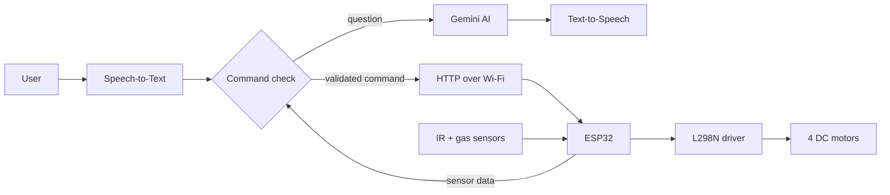

# VoxRover

**An AI-powered, human-interactive rover you can talk to. It drives on voice commands, answers questions with Google Gemini, and watches for gas and obstacles on its own.**

VoxRover splits the work between a laptop and an ESP32 car. The laptop handles speech, AI and a web dashboard. The ESP32 handles motors, sensors and safety, and only ever receives a small set of validated commands over Wi-Fi.

- **Live simulation (no hardware needed):** [VoxRover Simulator](https://claude.ai/artifact/FzngokottcaZZXBAHP9kk8)
- **Project report:** see the `docs/` folder

## Features

- Voice control: "move front", "move back", "move left", "move right", "stop", with an optional duration ("move left for two seconds")
- Conversation with Google Gemini, with automatic fallback to a backup model if one is slow
- Sensor questions answered from live data: "check gas", "is anything in front"
- Gas and smoke detection with a Flying Fish gas sensor, with a spoken warning
- IR obstacle sensor that stops the car and refuses to drive forward into an obstacle
- Web dashboard with a live gas gauge, obstacle status, drive pad, chat and microphone
- Speech output in a cloned ElevenLabs voice, with the Windows voice as a fallback

## How it works



The language model never controls the motors. Driving is decided locally from a fixed command list.


## Hardware

| Component | Qty | Role |
| --- | --- | --- |
| ESP32 DevKit V1 | 1 | Controller with Wi-Fi; runs the web server, reads sensors |
| L298N motor driver | 1 | Direction and PWM speed control |
| DC geared motors + chassis | 4 | Drive and steer (two per side) |
| Flying Fish gas sensor | 1 | Gas and smoke level (analog) |
| IR obstacle sensor | 1 | Obstacle detection (LOW = obstacle) |
| Battery pack | 1 | Motor power |
| 10 k and 20 k resistors | 1 each | Voltage divider for the gas sensor signal |
| Laptop with microphone and speaker | 1 | Runs the Python app |

### Wiring

| ESP32 pin | Connected to | Function |
| --- | --- | --- |
| GPIO 26 | L298N IN1 | Left motors, direction |
| GPIO 27 | L298N IN2 | Left motors, direction |
| GPIO 14 | L298N IN3 | Right motors, direction |
| GPIO 13 | L298N IN4 | Right motors, direction |
| GPIO 25 | L298N ENA | Left motors, PWM (jumper removed) |
| GPIO 33 | L298N ENB | Right motors, PWM (jumper removed) |
| GPIO 34 | Gas sensor AO, through divider | Analog gas level |
| GPIO 35 | Gas sensor DO, through divider | Digital threshold (optional) |
| GPIO 18 | IR sensor OUT | Obstacle detect |
| 3V3 | IR sensor VCC | Sensor power |
| VIN (5 V) | Gas sensor VCC | Sensor heater power |
| GND | All grounds | Common ground |

**Important:** the gas sensor runs at 5 V, so its outputs can reach 5 V. Use a divider (10 k from the sensor output to the pin, 20 k from the pin to GND) so the ESP32 sees at most 3.3 V. Join the battery negative, L298N GND and ESP32 GND.


## Project structure

```
robotCAR/
├── firmware/            ESP32 Arduino sketch (Arduino IDE)
├── static/
│   └── index.html       Dashboard page
├── docs/                Report and diagrams
├── voice_assistant.py   Voice assistant (speech, commands, Gemini)
├── stt.py               Microphone recording and speech-to-text
├── tts.py               ElevenLabs voice with Windows fallback
├── robot_link.py        HTTP link to the ESP32 and sensor reads
├── dashboard.py         Flask backend for the web dashboard
├── requirements.txt
└── .env                 Your keys (not committed)
```

## Setup

### 1. Flash the ESP32

1. Install the [Arduino IDE](https://www.arduino.cc/en/software) and add ESP32 board support.
2. Open the sketch in `firmware/`, set `WIFI_SSID` and `WIFI_PASS`, choose the **ESP32 Dev Module** board and upload.
3. Open the Serial Monitor at 115200 baud and note the IP address after reset.

The ESP32 supports **2.4 GHz** Wi-Fi only. The laptop and ESP32 must be on the same network.

### 2. Run the laptop software

```bash
python -m venv .venv
.venv\Scripts\activate          # Windows
pip install -r requirements.txt
```

Create a `.env` file next to the code:

```dotenv
GEMINI_API_KEY=your_gemini_key
ROBOT_IP=192.168.1.45
# Optional, for the cloned voice:
ELEVENLABS_API_KEY=your_elevenlabs_key
ELEVENLABS_VOICE_ID=your_voice_id
```

Use the ESP32's IP address with no `http://` and no trailing slash. **Never commit `.env`.**

Check the connection:

```bash
python robot_link.py      # should print "ok stop" and a sensor dictionary
```

### 3. Start

```bash
python voice_assistant.py   # talk to the rover
python dashboard.py         # web console at http://localhost:5001
```

Only one program can use the microphone at a time. Test with the wheels lifted off the ground first.

## Voice commands

| Say | What happens |
| --- | --- |
| "move front" / "move back" / "move left" / "move right" | Moves for 1 second |
| "move left for two seconds" | Moves for 2 seconds (3 s maximum) |
| "stop" | Stops immediately |
| "check gas" | Speaks the gas reading and alert state |
| "is anything in front" | Speaks the IR obstacle state |
| "check sensors" | Speaks both |
| anything else | Normal conversation with Gemini |

## ESP32 HTTP API

| Route | Action |
| --- | --- |
| `/forward`, `/backward`, `/left`, `/right` | Move for `?ms=` milliseconds (default 1000, max 3000) |
| `/stop` | Stop all motors |
| `/sensors` | JSON: `obstacle`, `gas_raw`, `gas_do`, `gas_alert`, `gas_warming_up`, `motion`, `wifi_rssi` |

## Safety

- Only five validated driving commands are accepted; Gemini cannot send motor instructions
- Every move ends by itself, with a hard 3 second maximum
- The ESP32 stops the car if the IR sensor sees an obstacle while moving forward
- Motors stop if Wi-Fi is lost, and all motor pins start LOW at boot
- The laptop app sends a stop command on exit
- API keys live in `.env`, which is kept out of version control

## Known limits

- Speech recognition needs internet and a clear voice
- Gemini reply time varies with the network
- The IR sensor has a short range; the gas value is relative, not calibrated in ppm
- Recalibrate the gas alert threshold for a different sensor or environment

## Roadmap (planned, not built yet)

- Autonomous obstacle avoidance
- Camera-based face detection and person following
- Multilingual voice interaction
- Mobile app control
- Offline conversational AI
- Cloud monitoring of sensor data
- Rear IR sensor for safe reversing

## By
- Abhishek Kallolimath
## License

Add a license of your choice (for example MIT) before publishing.